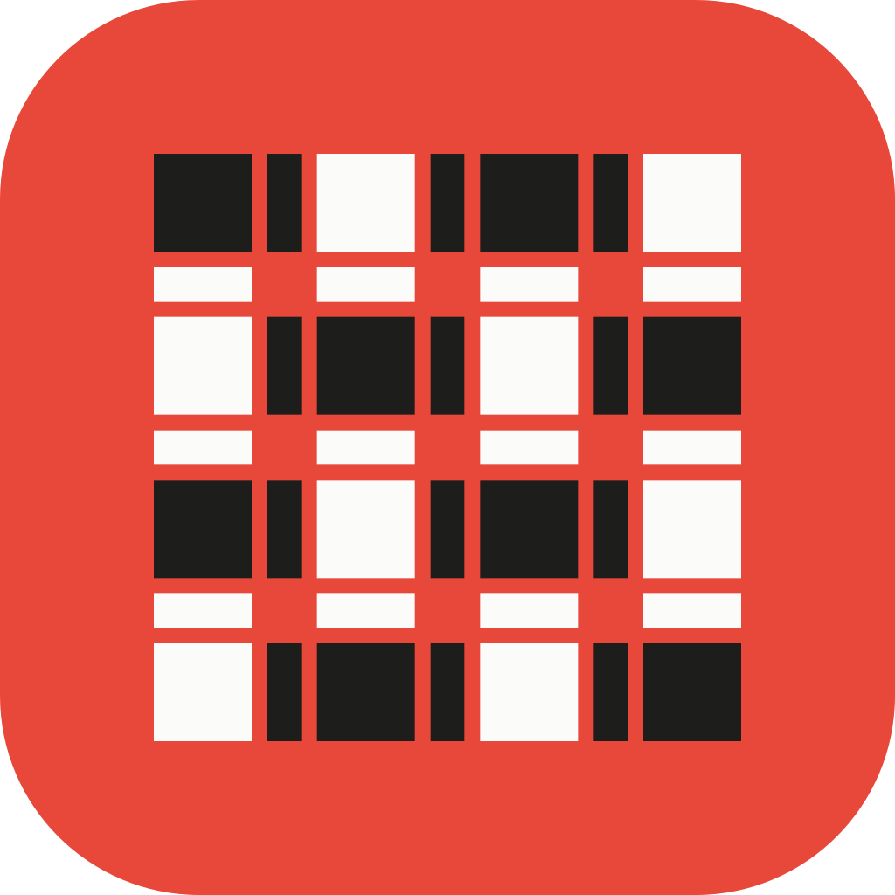
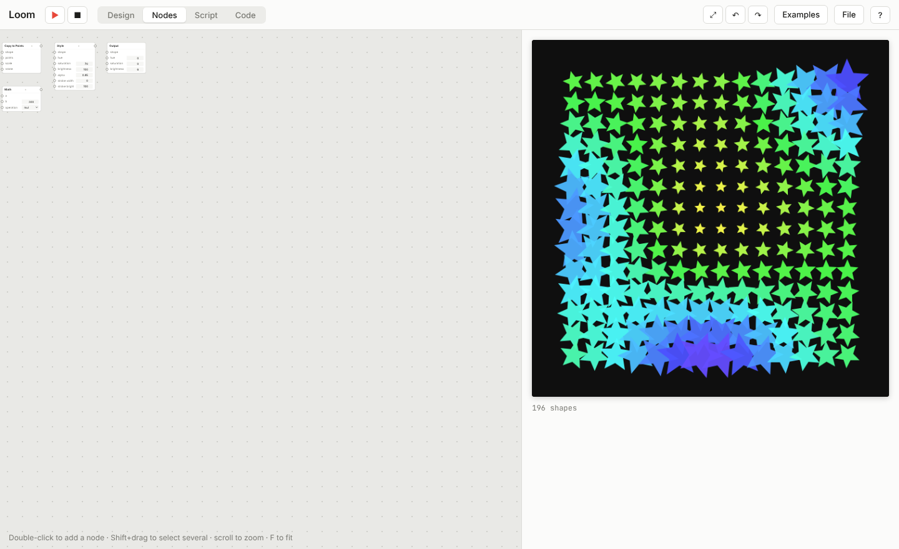

<p align="center"></p>

<h1 align="center">Loom</h1>

<p align="center"><b>Draw it. Animate it. Generate it.</b><br>
A free, open-source studio for designers and creative coders.</p>

<p align="center">
  <a href="https://github.com/RobArtCap45/Loom/actions/workflows/ci.yml"></a>
  <a href="LICENSE"></a>
</p>



Loom puts four ways of making things in one window, all editing the same sketch:

| | |
| --- | --- |
| **Design** | A vector editor with a bezier pen, shapes, layers and a keyframe timeline. Export PNG, SVG and video. |
| **Nodes** | Build generative art by wiring nodes: grids, noise, copies, bezier paths, union/subtract, align, distribute, your own custom nodes. |
| **Script** | The same node graph written as text, in a small language that reads like a recipe. Edit either side. |
| **Code** | Processing-style JavaScript with mouse and keyboard events, and more than 60 examples. |

No account, no cloud, no build step for the app itself. A sketch is one `.loom.json` file.

## Get Loom

- **In your browser:** open `app/index.html`, or run `npm run web` and visit http://localhost:8080. The hosted version lives at the project website.
- **Desktop app (macOS, Windows, Linux):** download an installer from [**Releases**](https://github.com/RobArtCap45/Loom/releases/latest).
- **From source:**

  ```bash
  git clone https://github.com/RobArtCap45/Loom.git
  cd Loom
  npm install     # needed for the desktop app and its build tools
  npm start       # opens the desktop app
  npm test        # syntax check, geometry tests, language tests
  ```

  Node.js 22.12 or newer. The web app itself needs nothing installed.

## Learn it

Start with **Examples** in the top bar, then read the docs:

- [User guide](docs/user-guide.md): the Design and Nodes tabs, shortcuts
- [Script language](docs/script-language.md) and [Code API](docs/code-api.md)
- [Node reference](docs/node-reference.md): every node and its inputs
- [Architecture](docs/architecture.md), [Desktop app](docs/desktop.md), [Website](docs/website.md)

## Repository

```
app/        the app (HTML, CSS, JavaScript; runs in a browser or in Electron)
desktop/    Electron wrapper: window, native menu, icons
website/    the project's landing page (static)
docs/       guides and reference
tests/      geometry and language tests (plain Node)
scripts/    small helper scripts (serve, build the site, generate docs)
.github/    CI, release builds, issue and pull request templates
```

## Contributing

Bug reports, new nodes, examples, docs and fixes are all welcome. Read [CONTRIBUTING.md](CONTRIBUTING.md) to get set up; it takes a few minutes. Please be kind: see the [code of conduct](CODE_OF_CONDUCT.md).

One rule matters a lot: **write your own examples and docs.** Loom's node names follow NodeBox and its code API follows Processing so they feel familiar, but their documentation and example programs are under other licenses, so nothing may be copied from them.

## Roadmap

1. **Design:** text (type to outlines), groups, boolean operations on design shapes, gradients, color palettes, animating colors.
2. **Interactivity:** state machines and triggers (like Rive), and exporting a self-contained animation that plays on the web.
3. **Language:** list literals, `if`, syntax highlighting and autocomplete in the Script tab, a command-line renderer.
4. **Desktop:** bundled fonts for fully offline use, auto-update, signed installers.

## License

Loom is released into the public domain under [CC0 1.0](LICENSE). Do whatever you like with it.
